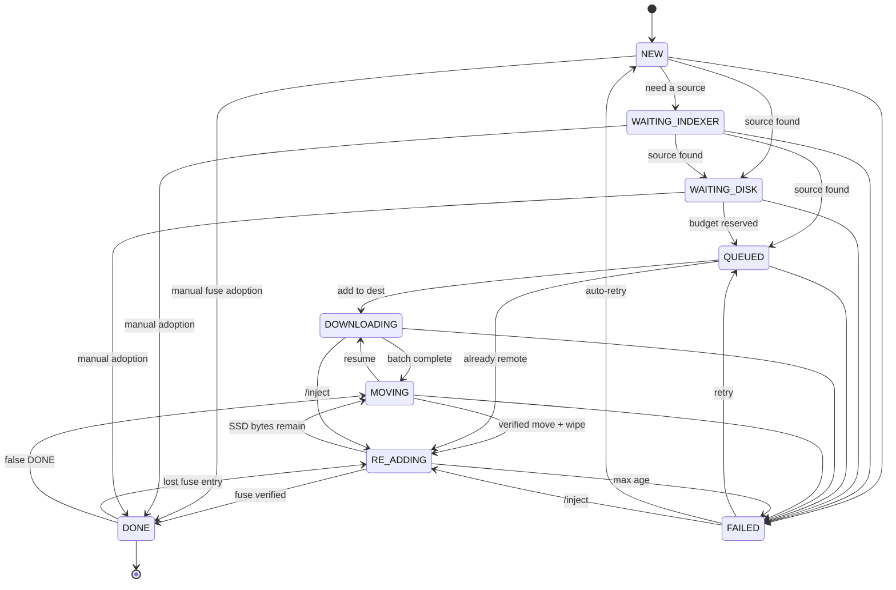

# Architecture

Racing Sync is one async daemon that moves a torrent through a fixed
pipeline. The design goal is: **never delete or report "done" on doubt.**
Everything below follows from that.

## Layout

```
src/racing_sync/
  __main__.py         CLI: run [--reset|--full --yes], forget, unignore, check-config, config summary
  config.py           Pydantic schema + cross-field validation
  config_alias.py     New capability-chain spellings -> the internal schema
  config_disposition.py  Every field's fate (keep/rename/deprecate) + path helpers
  config_summary.py   Read-only, secret-free summary + digest of a config
  chain.py            The pipeline as links: stage handoffs, derived terminal edges
  runtime.py          Typed read-through capability views over AppConfig
  composition.py      Builds the client/indexer/blob/watch graph for a config
  capabilities.py     Protocols the orchestrator depends on
  state.py            SQLite state machine (one schema spec drives all views)
  classifier.py       movie / episode / season / mixed
  batcher.py          SSD-aware episode batching
  coordinator*.py     The pipeline, split by stage:
    coordinator.py             loops + workers, transition/park primitives
    coordinator_admit.py       source pick, admission, watch intake, retries
    coordinator_download.py    batch download loop + completion wait
    coordinator_move.py        verified move, wipe, MOVING checkpoint replay
    coordinator_readd.py       fuse re-add drive + sustained-missing healer
    coordinator_fuse.py        late cross-seeds + fuse entry management
    coordinator_cleanup.py     VPS1 cleanup janitor
    coordinator_ssd.py         SSD budget + global reservation ledger
    coordinator_watchdog.py    dead-torrent watchdog + tracker-death cascade
    coordinator_inject.py      manual inject-to-fuse flow
    coordinator_picker.py      cross-seed source picker
    coordinator_content.py     stateless helpers (names, notify)
    coordinator_push.py        VPS1 push lane (copy, suppression, handoff)
    coordinator_racing_blobs.py bulk warm-up of the racing .torrent cache
  content_keys.py     One same-content rule (explicit size modes)
  fuse_gate.py        One fuse verifier (mount probe, expected files, confirm)
  path_ownership.py   One save-path rule: FUSE / SSD / FOREIGN / UNKNOWN
  recovery.py         Startup reconciler
  forget.py           Abandon-torrent off-switch
  rclone_ops.py       rclone subprocess wrapper (timeouts, kill/reap)
  seed_layout.py      One rule: which remote and which top folder a release lands in
  local_transfer.py   verified move to a mounted local dir/NAS (local_move)
  io_bounds.py        RPC/thread deadlines and chunking
  safety.py           Delete guards, daemon lock, reset refusals
  sftp_source.py      Pooled .torrent export + bulk tar fetch over SSH
  vps1_push.py        Preflight + detached `rclone copy` run on the racing box
  prowlarr.py         Indexer search + validated download
  watchdir.py         Watch-dir scanner + the one bencoded parser
  telegram_*.py       Control plane (commands, actions, routing, views)
  api.py              Optional FastAPI control plane
  clients/            qBittorrent + Deluge adapters
```

## Pipeline



The edge list is `ALLOWED` in `state.py`. `DONE` is terminal-ish: a lost
fuse entry demotes it back to `RE_ADDING`, a falsely adopted one to
`MOVING`; 5 rapid demotions in 24 h fail the row instead of flapping.
`FAILED → QUEUED/NEW` is manual and auto retry.

**Steps in order.** Discover on VPS1 → pick the SSD source (public copy,
Prowlarr cross-seed, or a direct export; manual fuse adoption short-circuits
to `DONE`) → reserve SSD budget → add to VPS2 paused → download in batches →
`rclone move` with a literal `--files-from-raw` list (verified: exit 0 and
the files gone) → re-add pointing at the fuse mount with `skip_check=True`
after the fuse gate passes → `DONE`. Public torrents land paused when
`cross_seed.pause_public_torrents_on_fuse` is set (default).

**Push from VPS1** (`[source.rclone_push]`, off by default). When no
download-target indexer carries the release, the racing box already holds
the bytes, so VPS1 can run a detached `rclone copy` onto the same remote
VPS2 seeds from instead of leeching them a second time. It is a copy, never
a move: deleting VPS1's files mid-race would cost the ratio, and deletion
stays the janitor's job. A live push parks its row — no SSD reservation, no
timeout leech, no `FAILED` for an expired indexer wait — and same-content
siblings defer to it, so one copy serves the group. Two of the section's own
timers bound it: `timeout_seconds` is the ceiling for one push (same verb as
`[transfer].timeout_seconds`, never the same value) and `poll_seconds` is the
cadence of the metadata-only progress listing — never a content read. A poll
that sees nothing new on a running push also reads that copy's own rclone log
on VPS1 (one bounded `test -f` / `wc -c` / `tail -c`, never a glob, never the
mount) and fails a provably dead job on the spot, so a stalled copy can no
longer squat a push slot until the ceiling; silence from a big in-flight
upload is treated as alive, and `timeout_seconds` stays the backstop. Preflight,
the file-list write and that log read run on a dedicated SSH dial of their own,
never on the pooled members the racing .torrent fetches use. The
existing fuse-evidence path then admits the row and injects. `/push_source`
or the act-sheet button starts one by hand; `auto_on_prowlarr_timeout` makes
the timeout — `[acquire].indexer_wait_seconds` counted from the first query,
a wait window rather than a staleness bound — prefer the push over the VPS2
leech, which stays as the fallback. `push_on_janitor_pressure` adds a third
trigger that invents no clock: it consumes the cleanup janitor's existing
verdict (`bursting`/`urgent` from `[cleanup]`'s low watermark and arrival-rate
arms) and pushes the releases already parked on an indexer miss, biggest
first, instead of letting a burst of arrivals fill VPS1 while each of them
waits out its window. Unknown free space counts as no pressure.

## Invariants (the single rules)

**Destructive steps.** Before any delete or wipe: re-read the row's state
and version, and classify the path with `path_ownership.classify_save_path`
(`FUSE` → never delete through the mount, `SSD` → local, `FOREIGN`/`UNKNOWN`
→ refuse). This gates forget, inject preemption, cleanup, and the MOVING
wipe.

**Writes.** `StateStore.upsert` takes `expected_state`/`expected_version`;
`update_columns` is the narrow write. One `(column, ddl)` spec in `state.py`
generates `CREATE TABLE`, the upgrade `ALTER`s, the blob-less projection and
`to_row`, and an import-time check refuses drift against the dataclass.

**Unknown is not absent.** A fuse probe that cannot answer returns
"unverifiable", never "missing"; a file-list RPC that fails parks the row; an
unreadable mount is an outage, not a content miss. Callers must park.

**Parks.** `_park_row` (any state), `_park_readd` (timer + reason) and
`_park_moving` (escalating counter) are the only "stay put and retry"
primitives. They record `last_error`, release in-memory slot maps, and never
resurrect a forgotten row.

**Content identity.** `content_keys.same_content` is the one rule, with
explicit modes: `require_size=True` for deferral/election (two unsized
releases must not defer forever), `allow_unknown=False` for destructive
grouping (name-only evidence never deletes). `watchdir.parse_torrent` is the
one `.torrent` parser (v1 SHA-1, v2 SHA-256, hybrid; v2-only is refused
because the pipeline is v1-keyed). Racing bytes are hash-validated against
the requested infohash before use: the row blob is the download torrent, so
returning it unvalidated would re-add the wrong hash. Deluge has no export
RPC, so the bytes come over SSH: one `tar` stream carries every racing
`.torrent` in a pass (`bulk_fetch_interval_seconds`), and the validated ones
are cached in the DB, so injection no longer depends on a per-torrent round
trip. Per-file SFTP reads stay as the fallback.

**Fuse verification.** `fuse_gate.verify_blob_on_mount` returns
`mount_ok` / `expected` / `missing`, with `confirm=True` re-probing once
before a cached absence counts. `_fuse_entry_split` decides entry placement
(an entry seeding from the SSD is not a fuse seed). The rclone index lags
while the remote is busy, so "accepted but not yet visible" parks — it is
never a failure and never `DONE`.

**Seed layout.** The download torrent and racing torrents can disagree on a
top-level folder. The move fixes the physical layout and records its top in
`seed_subdir`; a wrapped blob seeds at the mount root, while a flat blob is
re-added with its save_path one level inside that folder. A flat download
with folder-shaped racing siblings is moved into the folder, so every copy
can seed from one layout (movies and episodes alike). Paths stay exact on
POSIX: case-only folder variants are different layouts (logged at move), and
the fuse gate keeps VPS1 rather than accepting a seed qB cannot open.

**Retries and deadlines.** `retry.py` is the read-retry policy (bounded,
fatal errnos excluded). Every worker handler runs under a per-state budget
(`_STATE_WORK_BUDGET_S`); DOWNLOADING and MOVING own their poll deadlines
(stall/flush/hash-check windows, `move_timeout_seconds`). `offload()` takes
an optional timeout, used for the fuse probe and the SSD free-space probe.

**Memory.** One throttled sweep (`_sweep_runtime_maps`) prunes expired memos
and caps every per-hash map.

## Chain

The pipeline is a chain of links (`observe → acquire → stage → transfer →
seed`), resolved by `chain.py` from the config. Each link has providers:

- acquire: `auto` (indexer/export pick), `local` (one box: the racing copy
  is the staged copy), `external` (the operator copies; the daemon verifies
  at the seed path and never downloads);
- transfer: `rclone`, `local_move` (a mounted directory/NAS),
  `none`, `external` (operator moves the bytes);
- seed: `path` (re-add an entry at the seed path), `existing` (adopt an
  already-seeded library, add nothing), `none`.

Today's two-box deployment runs all of them; a shorter chain ends earlier.
The download and move completion points ask the chain for the next state,
and the state table tolerates the derived terminal edges (`DOWNLOADING →
DONE`, `MOVING → DONE`). Startup drains rows left in a disabled link before
the SSD ledger is rebuilt. Cleanup is skipped while the chain adds no seed
entry of its own (disabled or adopt-only), since its content-secured proof
follows that entry.

On one box (source and dest origins equal) the seeded entries are excluded
from intake and from cleanup grouping, so the janitor can only ever remove
the racing copy.

## SSD budget and batching

`ssd.max_inflight_bytes` is a global budget, not a per-torrent cap. Admission
reserves `min(total, cap)`; unknown sizes reserve the full cap (fail-closed).
Over-budget rows park in `WAITING_DISK` and re-check quietly (≤1/min).
After classification the reservation refines to the remaining footprint;
each completed batch tightens it further. Seasons are split into batches that
fit the frozen per-row cap; a batch is downloaded, verified, moved, and the
entry removed before the next starts, so the SSD holds at most one batch at a
time. Reservations release on `WAITING_DISK`/`RE_ADDING`/`DONE`/`FAILED`/
forget and rebuild from the DB after a crash.

## MOVING

A move checkpoints three stages — `moved` (plan persisted), `entry_deleted`
(dest entry removed), `wiped` (SSD cleaned). A fresh run and a crash-resumed
run execute the same `_replay_move_checkpoint` sequence; a failed stage
parks with its checkpoint intact and the next tick replays from there. A
hung remote raises `RcloneTimeoutError` after `move_timeout_seconds` and
parks (bytes are intact on SSD) — it never fails the row. Repeated MOVING
parks escalate to an ERROR log with the gate reason in `last_error`.

## Re-add and fuse lag

The fuse gate fails closed: the cross-seed's files must verify at the target
mount before anything is injected with `skip_check=True`. A sustained
absence (same files, mount healthy, SSD bytes also gone) older than
`readd_heal_missing_after_seconds` triggers a selective re-download + move,
capped; otherwise the row parks and eventually hits the 24 h max-age failure.
Supplementary private cross-seeds are harvested from `tracker_map` indexers
(same release, per-blob gate, memoized per row) — VPS1 supplements, never
bounds, the racing set.

Before any pick, a cheap pre-check probes the torrent-name root on the fuse
target (both configured mounts — a fresh row has no kind yet, and
`mount_unsorted` is usually nested inside `mount`) with one stat per mount
and no RPC. The probe also looks one level deep: content moved into a
release folder is matched by normalized folder name (extension and group
suffix ignored), and the folder is recorded as the row's physical top so
every later check looks in the same place. A per-poll sweep probes a bounded
number of waiting rows, so a manual move is adopted within one poll
interval instead of the row's indexer retry timer. Fully present bytes admit
straight from the row's own blob
(QUEUED, no SSD reservation); a *partly* present copy — an operator's manual
rclone move in progress, or fuse index lag — parks the row without injecting
and re-checks every `[rclone.fuse].manual_move_check_seconds` (default 1800)
for up to `manual_move_timeout_seconds` (default 43200, 0 disables), then
falls back to the normal SSD download. A single file that exceeds the SSD
cap uses the same window instead of failing at once — a hand-copied remote
version is its only path. The window start is persisted
(`fuse_wait_first_at`), so a restart keeps the deadline; after the ceiling it
latches (a row that cannot download fails rather than restarting the wait).

## Recovery and cleanup

Startup runs one fast snapshot pass: optimistic adoption, orphan parking and
ghost checks, no per-row RPCs. Byte verification and blob export heal lazily
on the next worker tick through the existing fail-closed gates. `POST
/api/recover` runs the full pass (`reconcile()` with inline verification),
safe against a live daemon because row writes are state/version-guarded and
adoption re-reads ownership before inserting.

The janitor deletes a VPS1 copy only when the row is `DONE`, the swarm is
quiet, the fuse entry is present, and the bytes verify — and only while the
disk actually needs the room: `[cleanup].low_watermark_free_bytes` is the
reclaim TRIGGER and `high_watermark_free_bytes` the TARGET, so a pass reclaims
biggest-first until free is back at the target, the verified rows run out, or
`per_run_cap` stops it (a cap that stops short logs the numbers and reports the
shortfall instead of claiming success). Time leaves the policy entirely: no
elapsed period and no idle fast lane makes a `DONE` row eligible, so a quiet
day deletes nothing however old the rows are. Eligibility is proof, not age.
Under disk pressure `MOVING` rows still go early — their content is NOT
secured yet, so that path keeps its own settle window (a quiet swarm for
`_MOVING_IDLE_CONFIRM_S`, with a cross-host `added_on` sanity check on the
fallback evidence) — and bytes on the SSD count as secured because VPS2 never
pulls content from VPS1. Every racing hash in the group must also be proven to
seed from the VPS2 mount, otherwise its `.torrent` is cached first (VPS1 is
kept when even that fails). It re-reads the row and version right before each
delete. With `[cleanup].ignore_activity_under_pressure`, a run that reads
pressure the same way the cadence does (bursting, or free space below the low
watermark) skips only the activity keep — a full scratch disk outranks a
leecher, and VPS2 takes over serving — while verification, protection, unknown
stats and `.torrent` preservation stay fail-closed. A pass that finds nothing
eligible reports why in one line (`nothing eligible (activity 17,
verification 3)`), and a pass that needed nothing says so before scanning
(`no space needed yet: ... (waiting for space 12)`).
An EMERGENCY — free space at/below `critical_watermark_free_bytes`, or a
release that arrived too big to fit — is a third, separately-named signal above
`pressured`/`bursting` and changes timing only: the janitor runs on its
emergency wake (bounded to `burst_janitor_interval_seconds / 5`, floor 15 s)
instead of the next cadence tick, because the next race cannot land.
Unverified rows, protected rows and rows with peers attached are still kept
exactly as before, and the report line says `... ; emergency on` when the
state is live.
A VPS1 whose free space cannot be measured at all (no `core.get_free_space`,
dead statvfs probe) is never read as roomy — that would silence the janitor
forever. Such a pass falls back to the proof-gated reclaim, bounded by
`per_run_cap`, and invents nothing: no target, no projected free space (both
report `unknown`), no pressure (so `ignore_activity_under_pressure` cannot
unlock), no emergency, and no early `MOVING` delete unless a release actually
failed to fit.

## Telegram

One `racing-sync online` message on startup, one long-lived Active Tasks card
(paginated, status filters — including the `🗄` tab of `DONE` rows whose files
the cached VPS1 listing still reports, each labelled secured/reclaiming/not
verifiable rather than counted down), and one
detail card per torrent. Every command
is registered in the `/` popup with a description; targets use a space
(`/cancel 3`) or an underscore (`/cancel_3`). Full list:
`docs/telegram-commands.md`. Destructive sheets re-resolve live at each tap,
are bound to the operator who opened them, and never touch fuse/remote
copies.

## API

Optional FastAPI: `GET /api/state`, `/api/active`, `/api/logs`, `/api/ssd`;
`POST /api/recover`, `/api/retry/{hash}`,
`/api/forget/{hash}?ignore=&delete_files=`, `/api/scan-watch`. Auth is a
static `X-API-Token`, or an nginx-injected `X-Authenticated-User` from
`trusted_proxies`.

## Config and logging

`config.example.toml` documents every key in the capability-chain spelling
(`[client]`, `[storage]`, `[remote]`, `[transfer]`, `[seed]`, `[indexers]`,
`[watch]`, `[acquire]`); `config.py` validates and cross-checks them. The
older names are rewritten onto the same internal schema by `config_alias.py`,
so old files keep working unchanged and both spellings resolve identically.
`config summary` prints the resolved shape and a secret-free digest.

`config init` writes the compact single-box starter; `config enable/disable`
flip optional features without rewriting comments, and `config explain`
prints the short form. `check-config` starts with the resolved chain
(topology, providers, targets, disabled features) and warns before a
disabled link strands rows.

Pipeline code never reads config sections: it asks a capability view
(`rt.storage.path`, `rt.transfer.remote_for(episode=...)`,
`rt.seed.manual_move_timeout_seconds`). `composition.py` is the only place
that maps a config onto concrete clients, the indexer client, the blob
source and the watch scanner. `[prowlarr.tracker_map]` maps announce-URL
substrings to indexer names (supplementary fuse cross-seeds only — the SSD
download search always walks `download_indexers` in priority order). Logs
are rotating files plus JSONL (secrets scrubbed), an in-memory ring buffer,
and an optional HTTPS sink; the state DB records transitions in `run_log`.

## Operational notes

- Run the destination client as its own user; the SSD `save_path` must be
  writable by it.
- Keep `log_dir` on a different filesystem from the SSD/state DB
  (startup warns when they share one).
- The fuse mount may be read-only to the client; it only reads from
  `save_path` after the files are there.
- Isolated batches re-fetch shared boundary pieces per batch: budget a few
  extra GB of swarm traffic per season.
- rclone tuning belongs under `[rclone]`; `[rclone.fuse]` extras are ignored
  with a warning, and `--config`/`--password-command`/`--ask-password` are
  rejected.
- HTTP is IPv4-only by default (`use_ipv6 = false`).
- The state DB can be inspected with the `sqlite3` CLI:
  `sqlite3 /var/lib/racing-sync/state.db "select state, count(*) from torrent_state group by state"`.

## Tests

`pytest -q` (add `-n auto --dist loadfile` for speed). The suite covers the
state machine, guards, moves, fuse verification, cleanup math, and the
Telegram protocol.
